# Projeto de Interface

## User Flow

**Objetivo:** Mapear de ponta a ponta as transições de tela e caminhos de decisão para os três perfis de usuários da plataforma.

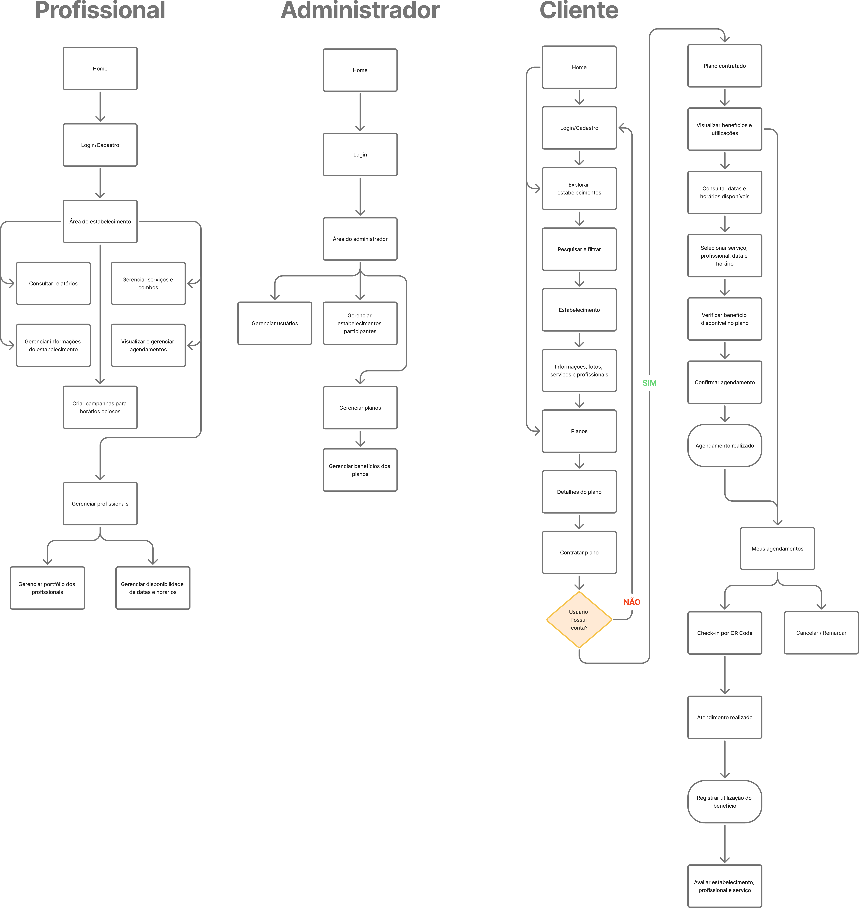

[Acessar o protótipo navegável no Figma](https://www.figma.com/board/a2keHMTQeT1FH1CiyMt3m1/UserFlow---VitaPass?node-id=0-1&t=UEkRs0qFjrLY7jmi-1)

## Wireframes

### Protótipo de baixa fidelidade

O conjunto contempla a jornada do cliente, a gestão dos estabelecimentos parceiros e as atividades de administração da plataforma.

As 36 telas foram relacionadas aos requisitos funcionais RF-01 a RF-36 descritos no documento do projeto. A numeração das telas identifica as imagens e é independente da numeração dos requisitos: uma mesma tela pode se relacionar a mais de uma RF, e uma RF pode aparecer em diferentes etapas do fluxo.

Por se tratar de um protótipo de baixa fidelidade, os blocos de conteúdo representam áreas a desenvolver. Nomes, datas, indicadores, planos e campanhas exibidos nas imagens são exemplos. As descrições explicam a finalidade de cada tela e os comportamentos previstos pelos requisitos; a associação a uma RF não constitui comprovação de implementação da funcionalidade.

[Acessar o protótipo navegável no Figma](https://www.figma.com/proto/XofQbIwBthbIxgzeKkyXVn/VittaPass-%E2%80%94-Wireframes-de-Baixa-Fidelidade?node-id=3-5&p=f&scaling=min-zoom&content-scaling=fixed&page-id=0%3A1&starting-point-node-id=3%3A5)

### Organização das telas

| Área | Telas | Finalidade |
| --- | --- | --- |
| [Jornada do cliente](#jornada-do-cliente) | 01 a 20 | Acesso, planos, busca, agendamento, check-in, histórico e avaliação. |
| [Área do estabelecimento](#area-do-estabelecimento) | 21 a 28 | Cadastro do parceiro, serviços, equipe, agenda, relatórios e campanhas. |
| [Administração da plataforma](#administracao-da-plataforma) | 29 a 33 | Visão geral e gestão de planos, benefícios, estabelecimentos e usuários. |
| [Notificações e situações específicas](#notificacoes-e-situacoes-especificas) | 34 a 36 | Comunicação, serviço não coberto e não comparecimento. |

### Jornada do cliente

Telas destinadas ao acesso e à utilização dos serviços pelo cliente.

#### 01 - Home pública

A página inicial apresenta a proposta do VittaPass e organiza os serviços nas categorias Beleza, Saúde e Bem-estar. O botão **Ver planos** direciona o cliente à consulta das assinaturas disponíveis, enquanto **Explorar** inicia a busca por estabelecimentos participantes. A área de destaque e os cartões de categorias estruturam o primeiro contato com a plataforma.

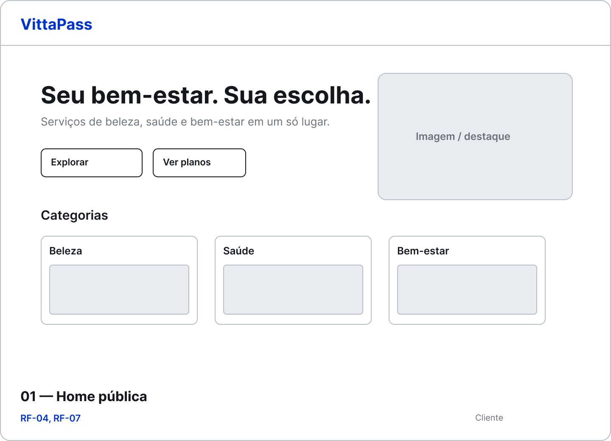

#### 02 - Cadastro

A tela de cadastro apresenta os campos nome, CPF/CNPJ, telefone, e-mail e senha, além da ação **Criar conta**. Sua finalidade é permitir o registro de uma conta de usuário na plataforma, conforme o RF-01. O formulário reúne as informações iniciais de identificação e acesso.

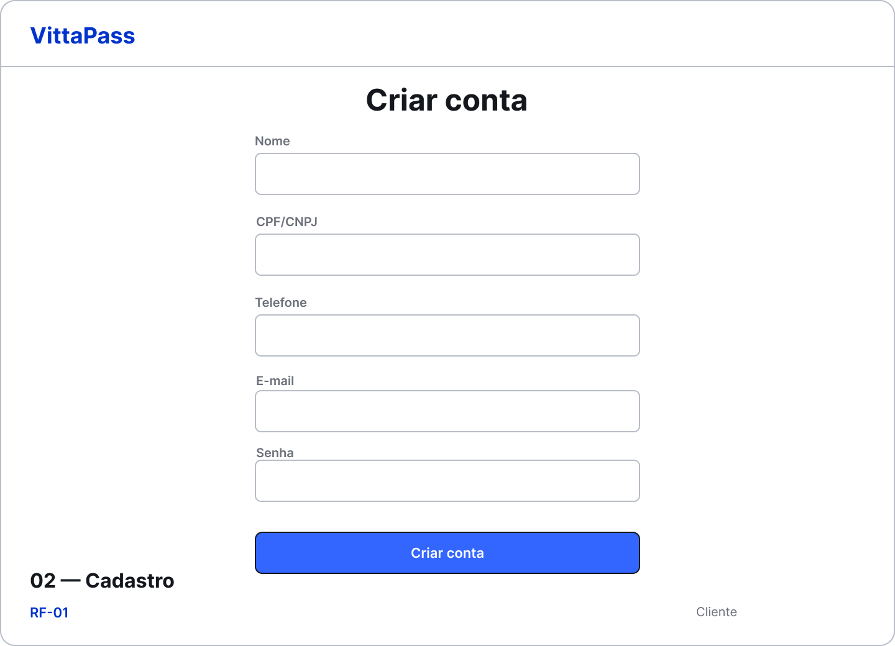

#### 03 - Login

A tela de acesso apresenta campos para CPF/CNPJ e senha, acompanhados do botão **Entrar**. Seu objetivo é permitir que o usuário acesse uma conta já cadastrada. O wireframe também inclui o link **Esqueci minha senha** como recurso complementar; o fluxo de recuperação não está detalhado nas imagens fornecidas.

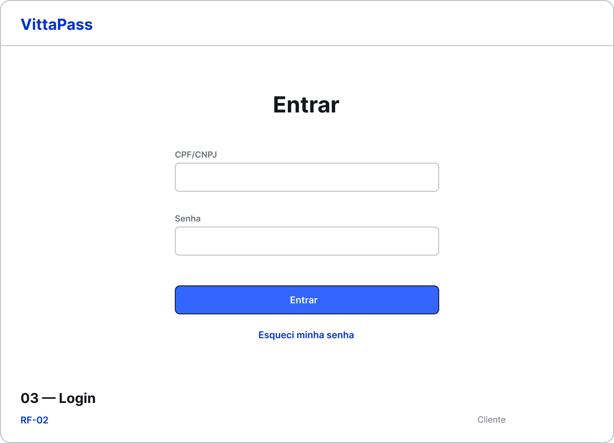

#### 04 - Perfil do cliente

A tela **Meu perfil** reúne os campos nome, e-mail/contato, telefone, cidade/endereço e descrição. O cliente pode consultar os dados de seu cadastro, realizar ajustes e utilizar a ação **Salvar alterações**. A interface corresponde à visualização e ao gerenciamento das informações pessoais previstos no RF-03.

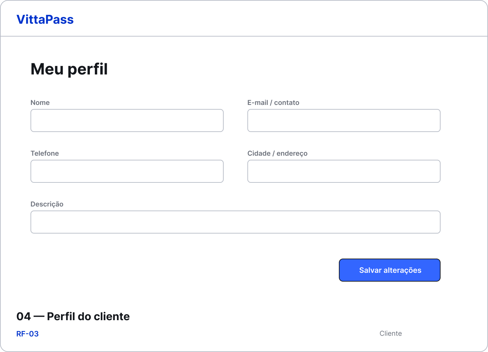

#### 05 - Planos disponíveis

A tela permite comparar as opções de assinatura por meio de cartões que apresentam espaço para mensalidade, benefícios, limites mensais e rede parceira. Cada opção possui a ação **Assinar**, que inicia a contratação. Os nomes Básico, Plus e Premium compõem o exemplo apresentado no wireframe; os valores e as condições de cada plano ainda devem ser definidos no projeto.

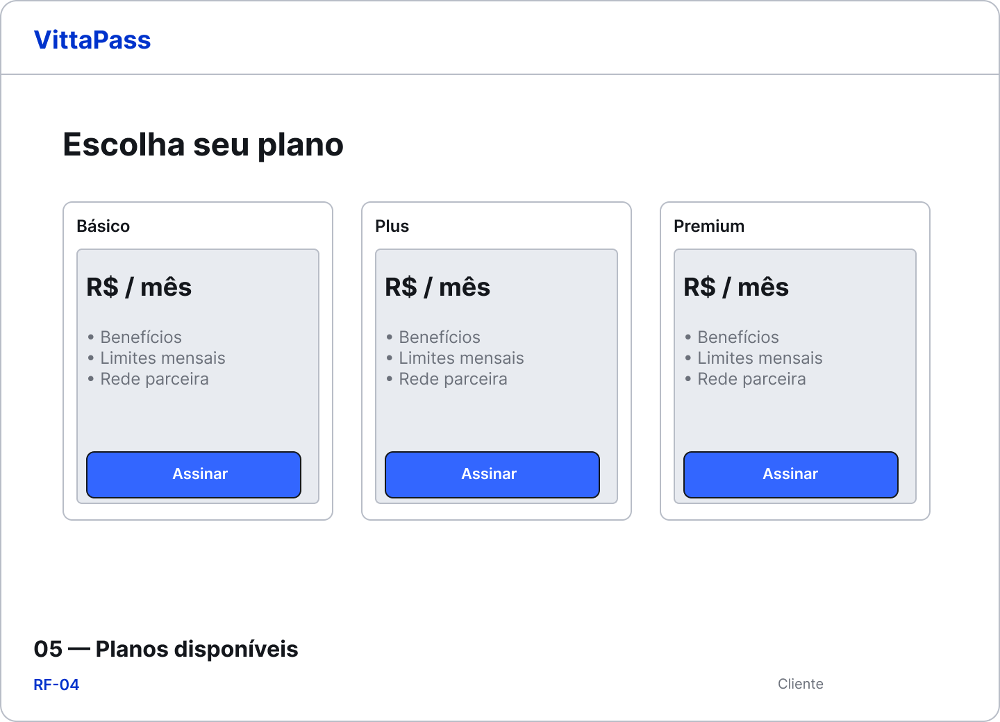

#### 06 - Contratação do plano

A tela de contratação apresenta uma área de resumo do plano escolhido e um formulário com nome no cartão, número do cartão, validade e CVV. A ação **Confirmar contratação** representa a conclusão da solicitação de assinatura prevista no RF-05. O wireframe descreve a organização da interface de contratação; a integração de pagamento não é demonstrada pelas imagens.

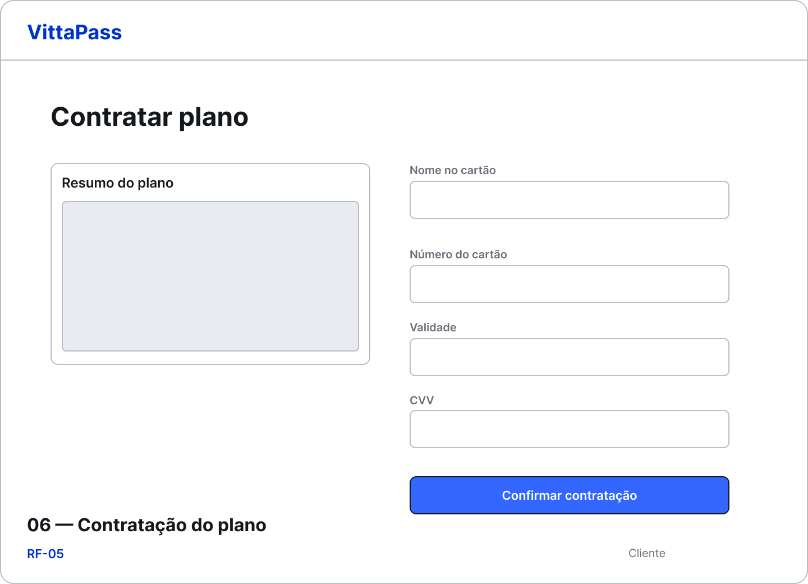

#### 07 - Meu plano e saldo

A tela **Meu plano** apresenta o plano contratado e indicadores de saldo separados pelas categorias Beleza, Saúde e Bem-estar. Seu objetivo é permitir que o cliente consulte os benefícios de sua assinatura e as quantidades de utilizações disponíveis. Os indicadores numéricos do wireframe são exemplos de apresentação dessas informações.

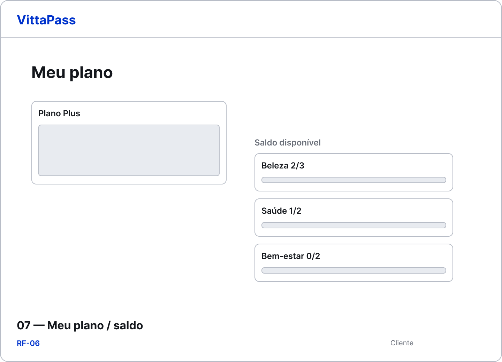

#### 08 - Vitrine de estabelecimentos

A vitrine apresenta um campo de busca, filtros de localização, serviço e disponibilidade, além de uma listagem de estabelecimentos participantes. A pesquisa permite localizar parceiros, enquanto os filtros ajudam a restringir os resultados às necessidades do cliente. A seleção de um estabelecimento conduz à consulta de seu perfil no fluxo proposto.

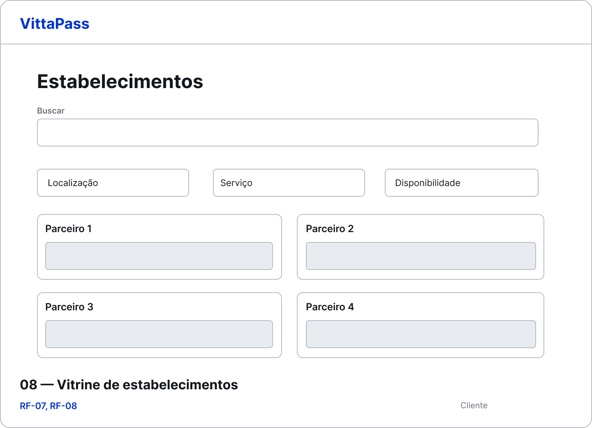

#### 09 - Perfil do estabelecimento - Visão do cliente

A tela apresenta a identificação do estabelecimento, uma referência de endereço, nota de avaliação, espaços para fotografias e uma área de serviços disponíveis. O botão **Agendar** dá continuidade à jornada de contratação de um atendimento. Essa organização permite ao cliente conhecer o parceiro antes de escolher o serviço.

O RF-09 está associado às informações do estabelecimento. O RF-24 aparece de forma parcial, por meio da nota e da referência a avaliações: a leitura dos comentários de outros usuários e das avaliações dos serviços ainda precisa ser detalhada em uma área ou tela específica.

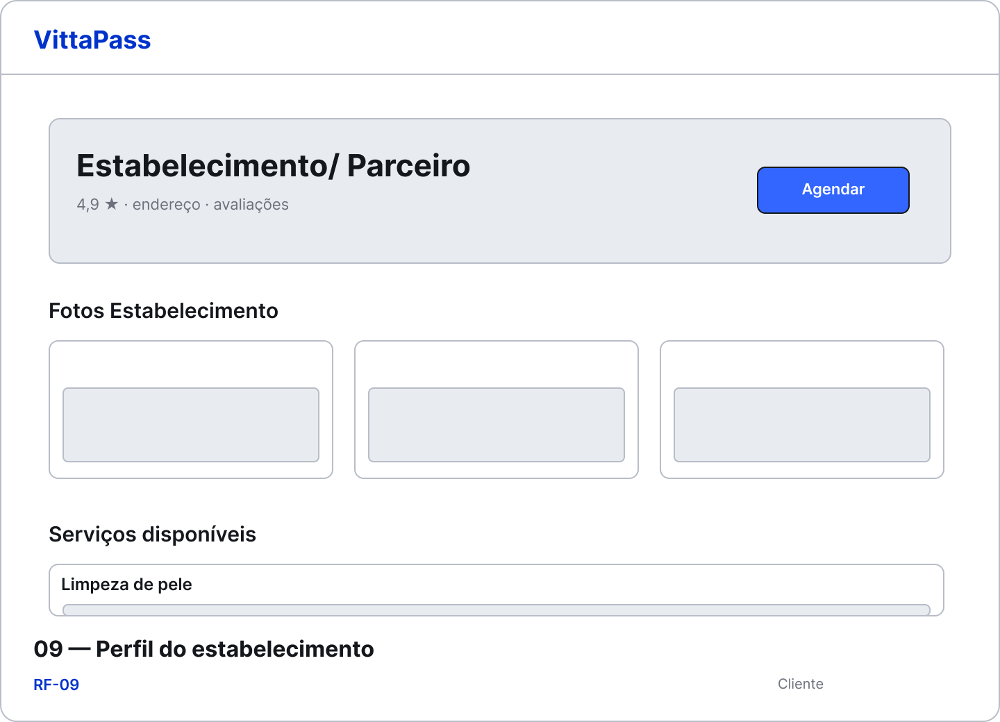

#### 10 - Catálogo de serviços

O catálogo organiza os serviços do estabelecimento em uma lista, com exemplos como limpeza de pele, massagem relaxante e corte com hidratação. Cada item possui uma área reservada ao detalhamento. Conforme o RF-10, esse conteúdo deve informar nome, descrição, duração e condições de utilização do serviço; no wireframe, parte dessas informações ainda está representada por blocos de conteúdo.

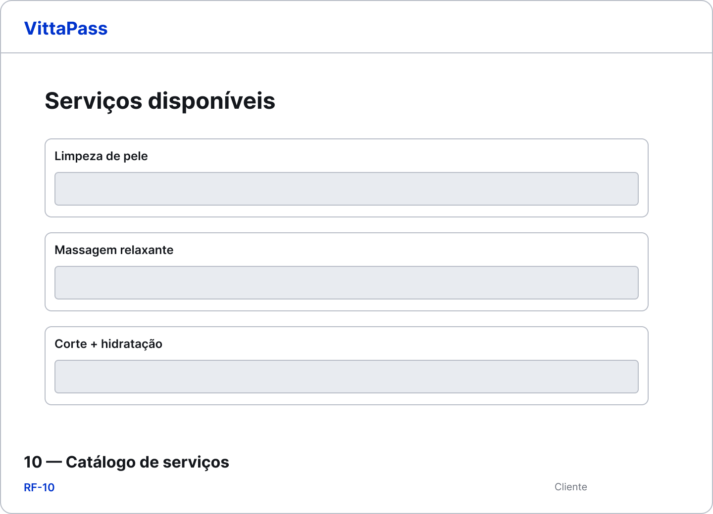

#### 11 - Profissionais

A tela apresenta os profissionais do estabelecimento em cartões individuais, com nome e área reservada às informações de cada integrante. A organização favorece a consulta da equipe disponível antes do agendamento. Os cartões funcionam como pontos de acesso ao detalhamento dos profissionais no fluxo proposto, em atendimento ao RF-11.

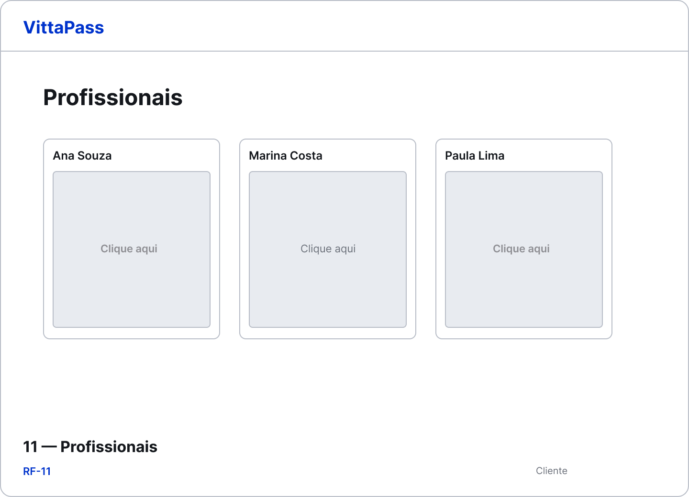

#### 12 - Portfólio profissional

A tela de portfólio identifica o profissional selecionado e apresenta uma galeria com espaços para fotografias de trabalhos realizados. O objetivo é permitir que o cliente conheça exemplos de atendimentos anteriores e tenha referências para sua escolha. A ação **Agendar** oferece continuidade à jornada após a consulta do portfólio.

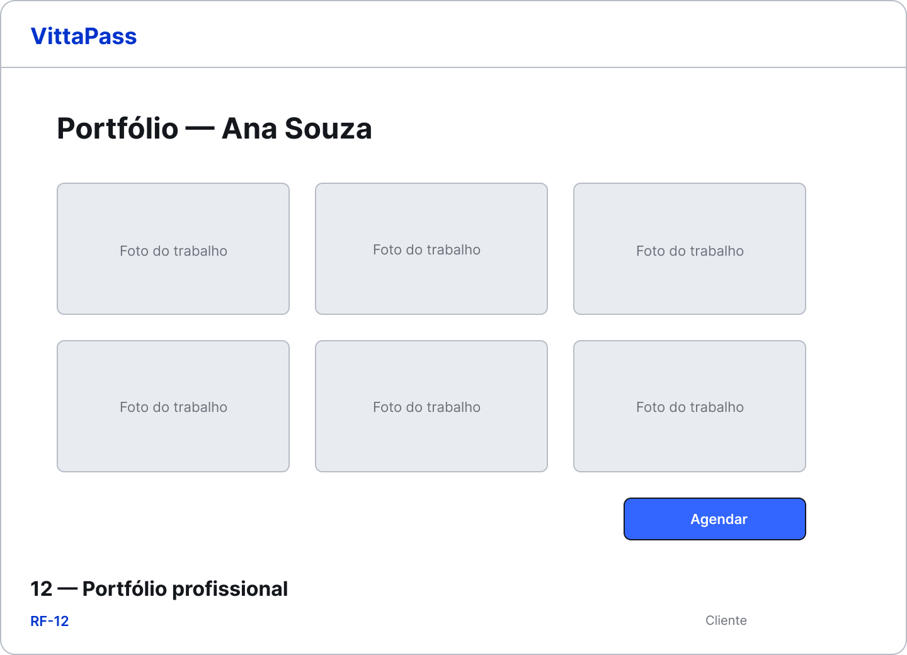

#### 13 - Seleção de agendamento

A tela organiza o agendamento em quatro escolhas: serviço, profissional, data e horário. Conforme o RF-13, as opções de data e horário devem refletir a disponibilidade do estabelecimento. O RF-14 orienta a composição do agendamento com todos esses dados.

No fluxo proposto, o estabelecimento é escolhido na etapa de consulta aos parceiros; este formulário dá continuidade à seleção. A ação **Confirmar** encaminha a solicitação para a validação do plano e a confirmação do agendamento.

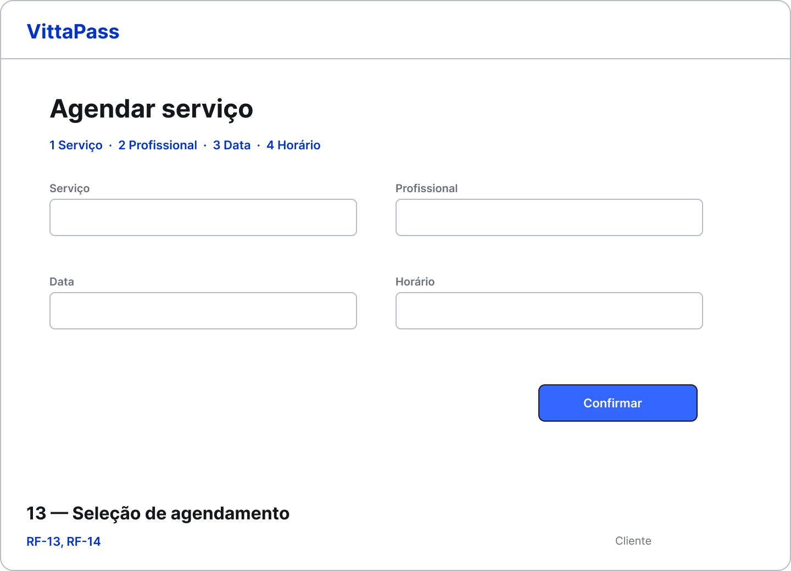

#### 14 - Validação do plano

A tela representa a etapa de verificação do serviço selecionado em relação ao plano contratado. O wireframe apresenta a mensagem de validação e uma área para indicar o resultado **coberto** ou **não coberto**. Essa etapa corresponde ao RF-15 e orienta a continuidade da solicitação de agendamento ou a apresentação do aviso de serviço não coberto.

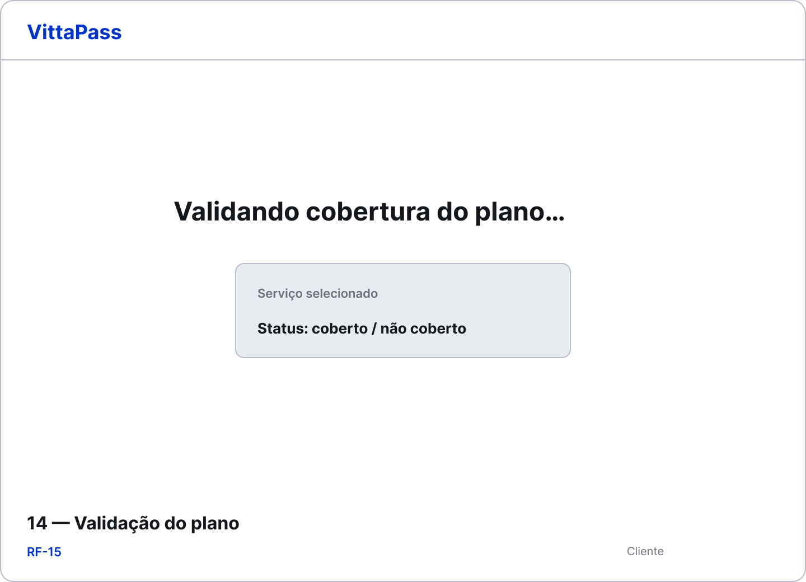

#### 15 - Confirmação do agendamento

A tela apresenta a mensagem **Agendamento confirmado**, uma área de resumo associada ao estabelecimento e as ações **Meus agendamentos** e **Voltar ao início**. Ela fornece ao cliente um retorno visual sobre a conclusão da solicitação prevista no RF-14.

O RF-34 está relacionado ao aviso dessa confirmação ao cliente e ao estabelecimento. A imagem mostra a confirmação na interface; as notificações correspondentes são representadas na tela 34.

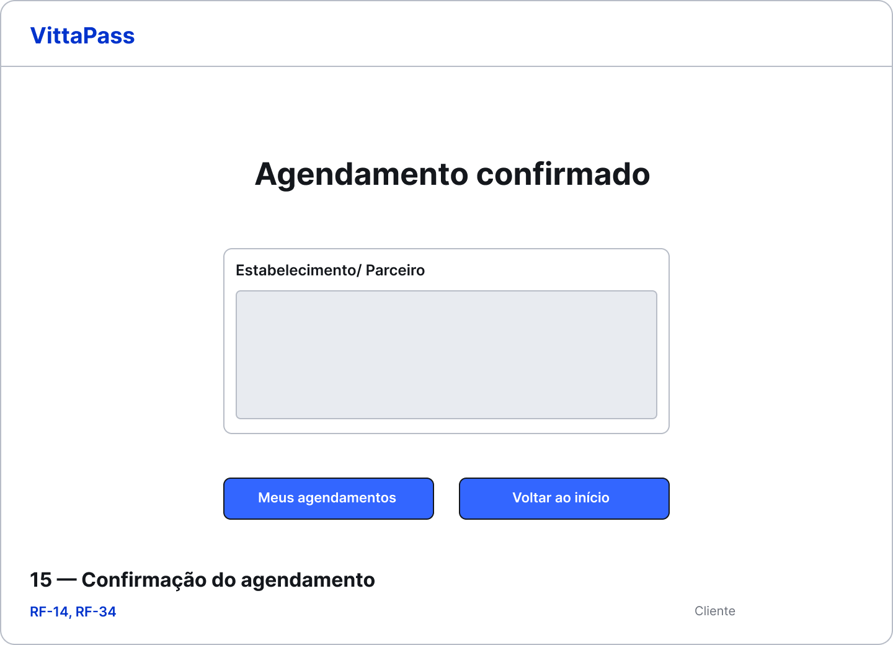

#### 16 - Check-in por QR Code

A tela apresenta uma área de câmera/leitura e orienta o cliente a apontar o dispositivo para o QR Code do estabelecimento. Essa interação representa o check-in previsto no RF-16. Conforme o RF-17, após a confirmação do check-in, o sistema deve registrar a realização do atendimento.

A imagem representa a etapa de leitura. A validação do código e o registro do atendimento constituem os comportamentos previstos pelos requisitos associados.

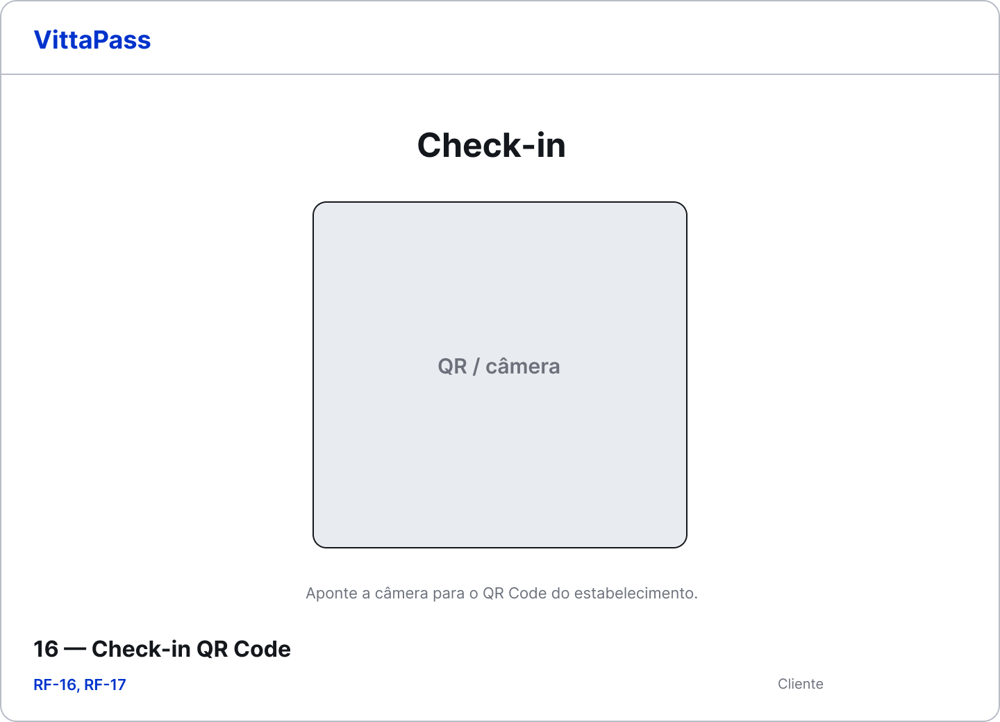

#### 17 - Meus agendamentos

A tela reúne os agendamentos do cliente em uma lista organizada por data e horário. Cada item possui uma ação **Detalhes**, destinada à consulta das informações do compromisso selecionado. A interface atende ao objetivo do RF-20 de permitir que o cliente visualize seus próprios agendamentos.

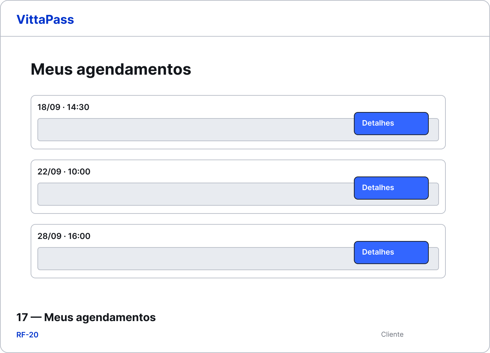

#### 18 - Cancelar ou remarcar agendamento

A tela apresenta o agendamento atual, campos para nova data e novo horário e as ações **Remarcar** e **Cancelar**. O cliente pode solicitar uma alteração ou o cancelamento do compromisso, conforme o RF-21. As mudanças devem observar a disponibilidade e as regras de prazo adotadas pelo projeto; o documento de requisitos não estabelece um prazo numérico de cancelamento.

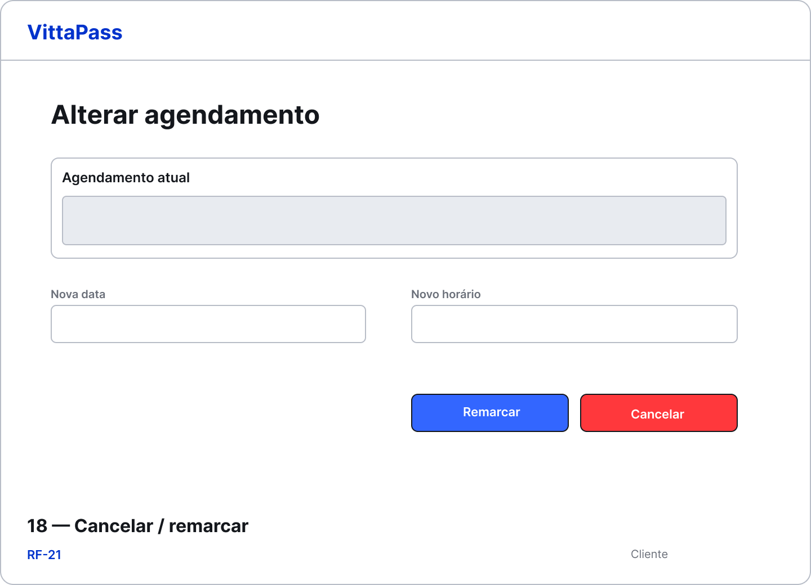

#### 19 - Histórico de benefícios

A tela apresenta uma lista de utilizações anteriores, identificadas pelo serviço e pela data, permitindo ao cliente consultar o histórico de seus benefícios conforme o RF-22.

O RF-19 define a origem desses registros: a utilização deve ser registrada após a realização do atendimento ou em caso de não comparecimento sem cancelamento dentro do prazo estabelecido. O histórico deve refletir essas regras de utilização; a imagem exemplifica a organização da consulta.

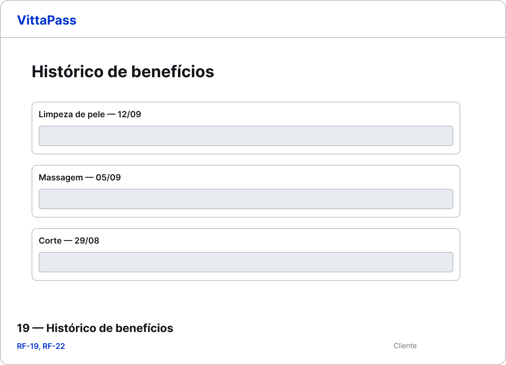

#### 20 - Avaliação pós-atendimento

A tela apresenta uma seleção de estrelas, uma área de comentário e a ação **Enviar avaliação**, destinada ao retorno do cliente após o atendimento. Conforme o RF-23, a avaliação deve abranger o estabelecimento, o profissional e o serviço. O wireframe usa um formulário geral; a identificação ou separação desses três aspectos ainda precisa ser detalhada na evolução da interface.

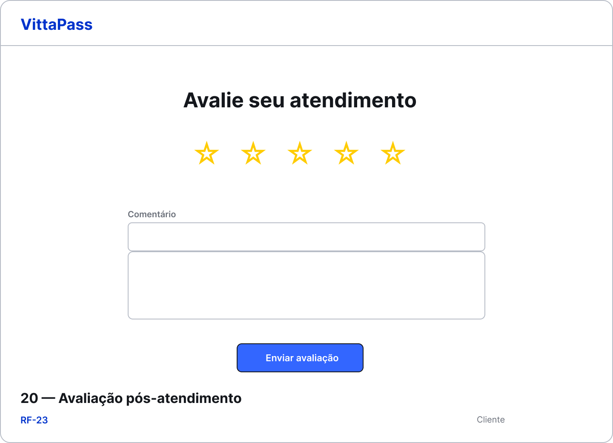

### Área do estabelecimento

Telas destinadas ao cadastro e à operação dos estabelecimentos parceiros.

#### 21 - Dashboard do parceiro

O painel do parceiro apresenta áreas de resumo para os atendimentos do dia, a ocupação e o faturamento, além de uma região de visão geral. Sua finalidade é apoiar o acompanhamento da operação do estabelecimento. O RF-29 relaciona-se à consulta e à gestão dos agendamentos, enquanto o RF-35 orienta a apresentação das informações gerenciais detalhadas na tela de relatórios.

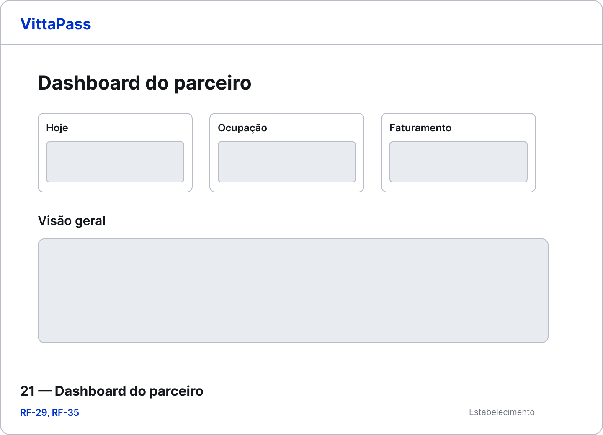

#### 22 - Perfil do estabelecimento - gestão do parceiro

A tela **Perfil do salão** apresenta campos para nome, e-mail/contato, telefone, cidade/endereço e descrição, acompanhados da ação **Salvar alterações**. O formulário organiza as informações do parceiro e apoia seu cadastro e sua atualização na plataforma, conforme o RF-25. Trata-se da visão de gestão do estabelecimento, complementar ao perfil consultado pelo cliente na tela 09.

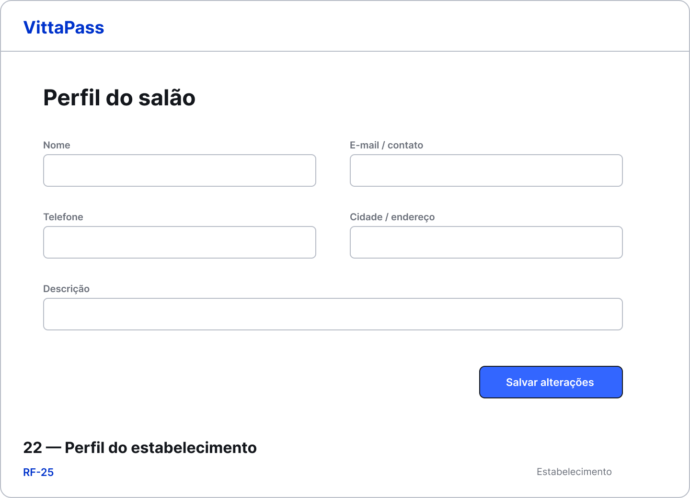

#### 23 - Gestão de serviços e combos

A tela apresenta o catálogo do estabelecimento em uma lista, com ação **Novo** e comandos **Editar** para os itens cadastrados. Seu objetivo é permitir o cadastro e a manutenção dos serviços oferecidos, conforme o RF-26. Os combos também integram essa organização, de acordo com o perfil do estabelecimento descrito no projeto. Os formulários de detalhamento dos itens não aparecem neste conjunto de imagens.

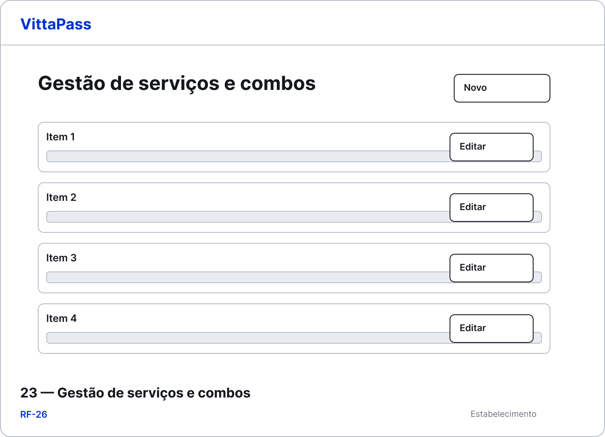

#### 24 - Gestão de profissionais

A tela organiza os profissionais cadastrados em uma lista com ações **Novo** e **Editar**. Essa estrutura permite iniciar o cadastro de integrantes da equipe e acessar a manutenção de seus dados, atendendo ao RF-27. As informações cadastradas apoiam a consulta dos profissionais pelo cliente e a organização da disponibilidade de atendimento.

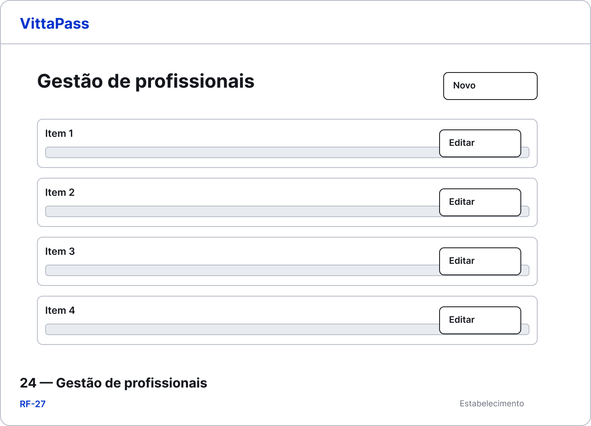

#### 25 - Disponibilidade e horários

A tela permite selecionar um profissional e apresenta uma área para calendário semanal e blocos de horário. A ação **Salvar horários** representa a confirmação da disponibilidade configurada pelo estabelecimento. O RF-28 orienta a gestão de datas e horários, que servem de referência para as opções exibidas ao cliente durante o agendamento.

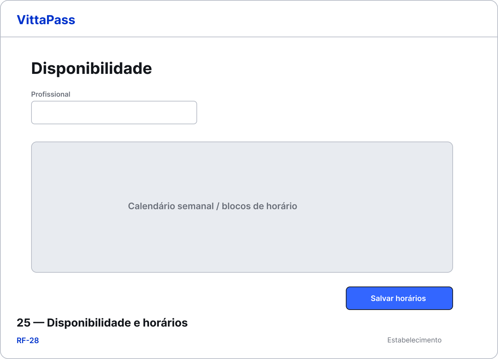

#### 26 - Agenda diária

A agenda organiza os compromissos do estabelecimento por horário, com informações de cliente, serviço, profissional e status. Sua função principal corresponde ao RF-29: visualizar e gerenciar os agendamentos realizados.

A tela também se relaciona ao acompanhamento de não comparecimentos previsto no RF-18 e aos eventos de agendamento, alteração e cancelamento que originam notificações conforme o RF-34. A identificação de faltas deve observar a existência de check-in e de cancelamento dentro do prazo estabelecido. As mensagens de notificação são detalhadas na tela 34.

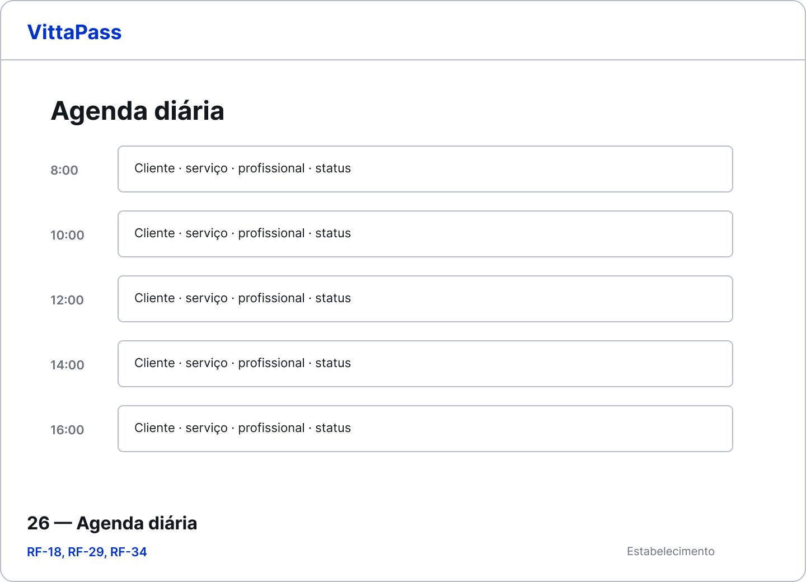

#### 27 - Relatórios gerenciais

A tela apresenta áreas para indicadores de agendamentos, faturamento e ocupação, acompanhadas de um espaço destinado ao gráfico de horários de pico e ociosidade. Conforme o RF-35, esses relatórios devem ajudar o estabelecimento a acompanhar a operação e identificar períodos de maior ou menor movimento. O wireframe define os espaços de apresentação dos dados, sem resultados numéricos consolidados.

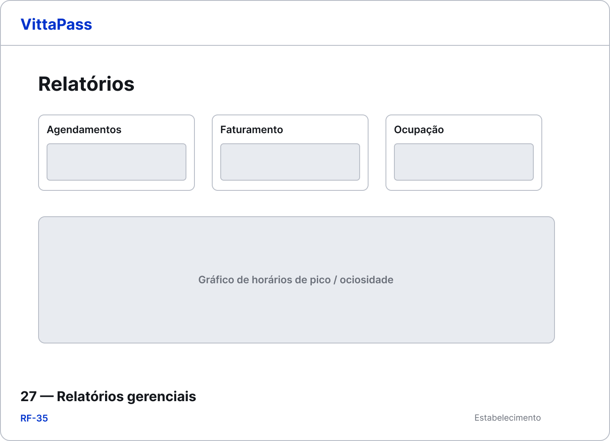

#### 28 - Campanhas de horários ociosos

A tela apresenta uma lista de campanhas e a ação **Nova campanha**, apoiando a criação e a gestão de iniciativas voltadas aos horários de menor movimento. Essa funcionalidade corresponde ao RF-36. Os títulos e o percentual exibidos na imagem são exemplos de conteúdo; as condições e os períodos de cada campanha devem ser definidos pelo estabelecimento.

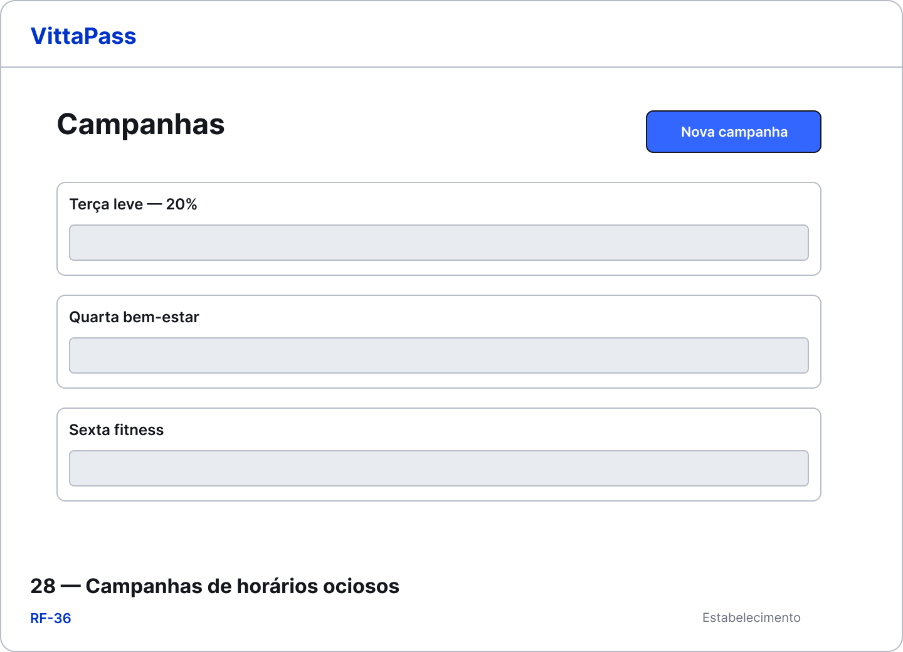

### Administração da plataforma

Telas destinadas às atividades do administrador do VittaPass.

#### 29 - Dashboard administrativo

O painel administrativo apresenta uma visão geral da plataforma, organizada em cartões de resumo e uma área de acompanhamento. Ele funciona como a visão inicial do administrador no conjunto de wireframes. As operações relativas aos RF-30, RF-31, RF-32 e RF-33 são detalhadas, respectivamente, nas telas de gestão de planos, benefícios, estabelecimentos e usuários.

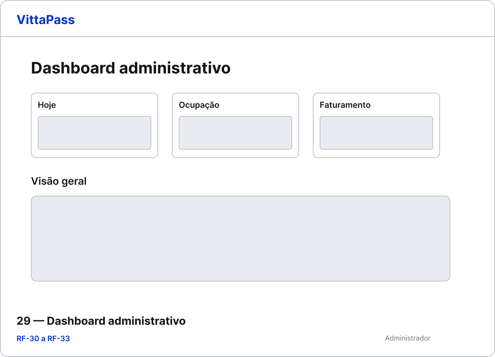

#### 30 - Gestão de planos

A tela apresenta os planos cadastrados em uma lista, com ação **Novo** e comandos **Editar**. Seu objetivo é permitir que o administrador cadastre e gerencie as opções de assinatura disponíveis na plataforma, conforme o RF-30. A definição dos benefícios associados a essas opções é tratada na tela de gestão de benefícios.

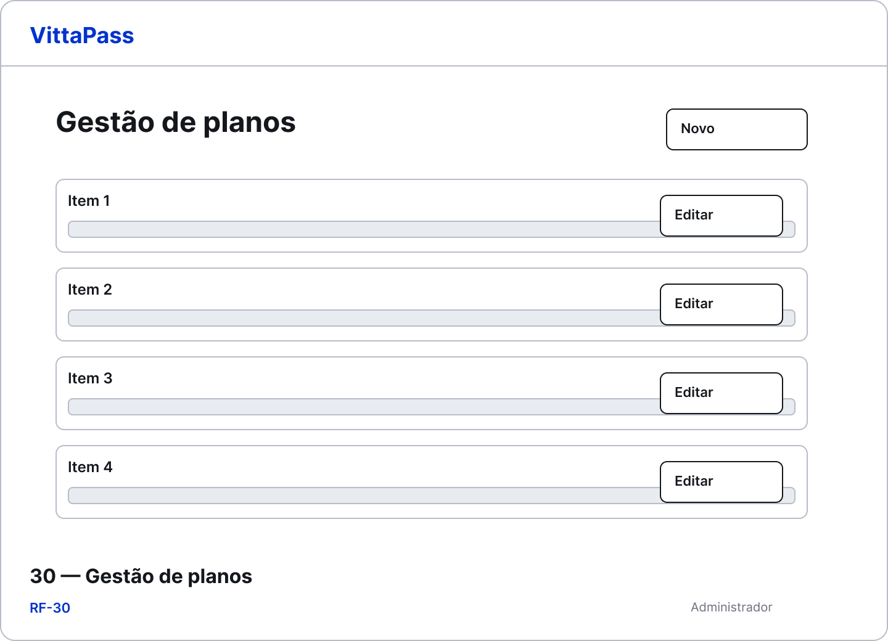

#### 31 - Gestão de benefícios

A tela apresenta uma listagem de benefícios com ações **Novo** e **Editar**, destinada ao administrador. O RF-31 orienta o cadastro e o gerenciamento dos benefícios associados aos planos. No projeto, essa gestão deve permitir definir os serviços, categorias e quantidades de utilização de cada assinatura; o wireframe representa a listagem inicial dessa função.

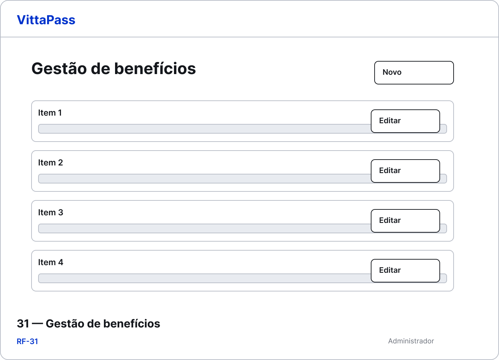

#### 32 - Gestão de estabelecimentos

A tela apresenta os estabelecimentos da plataforma em uma lista, com ações **Novo** e **Editar**. Sua finalidade é apoiar a administração da rede de parceiros. O RF-32 prevê cadastrar, editar e remover estabelecimentos; a opção de remoção ainda precisa ser detalhada, pois não aparece no wireframe fornecido.

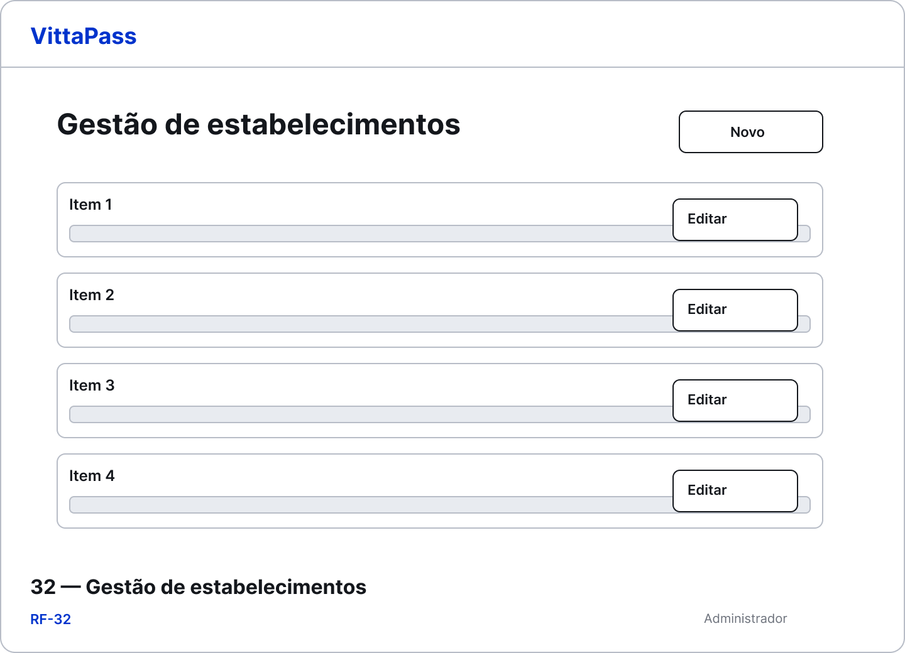

#### 33 - Gestão de usuários

A tela apresenta os usuários cadastrados em uma lista com ações **Novo** e **Editar**. O objetivo é apoiar o gerenciamento da base de usuários pelo administrador, conforme o RF-33. Os formulários e as informações detalhadas de cada cadastro deverão complementar essa visão de listagem na evolução do protótipo.

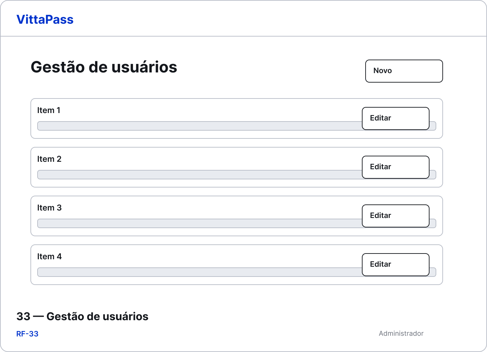

### Notificações e situações específicas

Telas de comunicação e de tratamento de situações que complementam os fluxos principais.

#### 34 - Notificações

A tela reúne avisos de confirmação de agendamento, lembrete de atendimento, alteração e cancelamento. Sua finalidade é manter cliente e estabelecimento informados sobre os compromissos e suas mudanças, conforme o RF-34. O wireframe representa a consulta das mensagens na interface, sem especificar canais externos de envio.

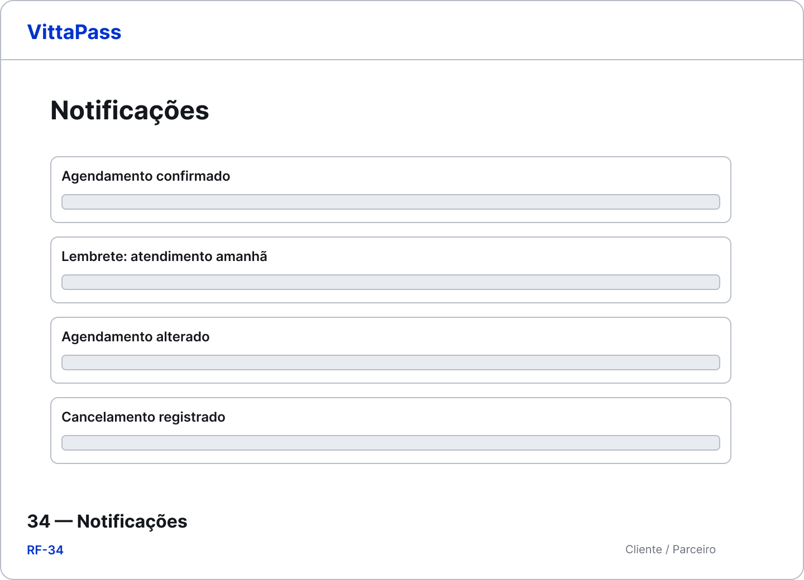

#### 35 - Serviço não coberto

A tela apresenta o resultado negativo da verificação do serviço no plano contratado. A mensagem informa a indisponibilidade do serviço no plano atual e oferece as ações **Outros serviços** e **Comparar planos**. Esse estado complementa a validação prevista no RF-15 e orienta o cliente a continuar sua busca por uma opção compatível.

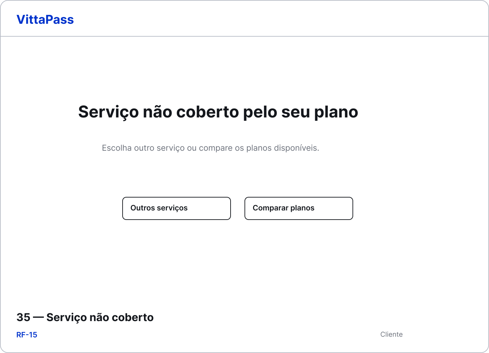

#### 36 - Não comparecimento

A tela apresenta ao estabelecimento um agendamento sem check-in e a ação **Confirmar registro**. O RF-18 determina que o sistema identifique o não comparecimento quando não houver check-in nem cancelamento dentro do prazo estabelecido. O RF-19 prevê o registro da utilização do benefício nessa situação.

A confirmação deve considerar essas duas condições, além do prazo aplicável. O wireframe representa o estado de não comparecimento, sem definir a duração desse prazo.

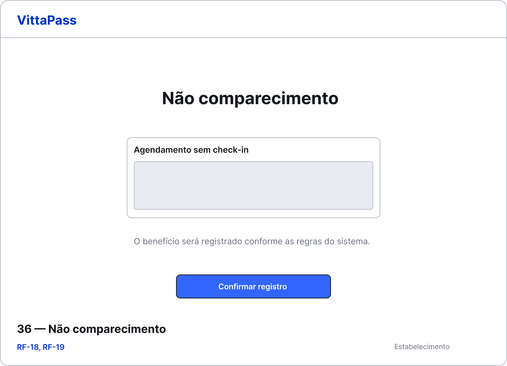
